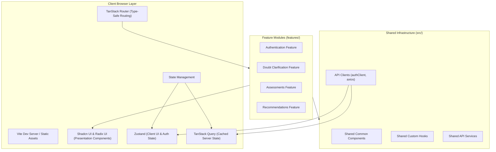
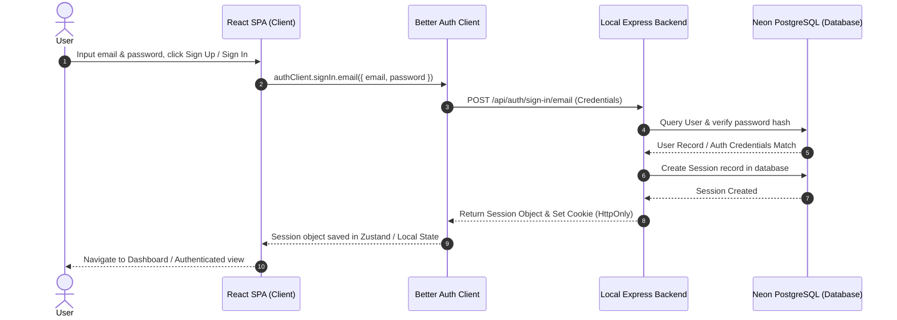
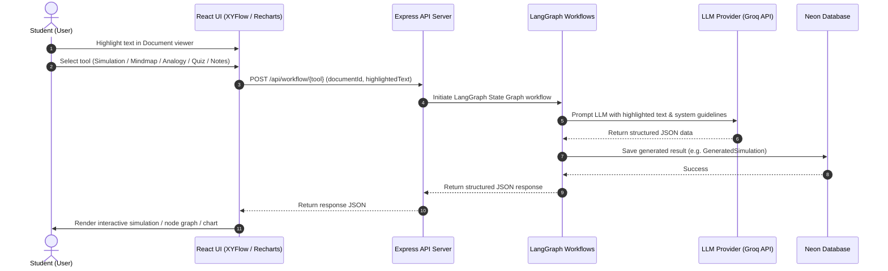

# Learnflowai - Frontend

An AI-powered learning assistance platform that helps identify skill gaps, clarify doubts, assess competency levels, and provide personalized learning paths. The frontend is built using a modern, scalable, and type-safe React architecture focused on maintainability, performance, and responsive user experience.

---

## Architecture Overview

The frontend application follows a Feature-Based Architecture (also referred to as Co-located Monolith). This architecture isolates business logic within self-contained modules, preventing cross-cutting concerns from creating tightly coupled components.

### Folder Strategy

```
src/
├── assets/                  # Static assets (images, fonts)
├── components/              # Global shared components
│   ├── common/              # Layout placeholders, cards, custom buttons
│   └── ui/                  # Shadcn UI accessible primitives
├── constants/               # Global constants and configurations
├── hooks/                   # Application-wide React hooks
├── layouts/                 # Page scaffolding templates
├── lib/                     # Client libraries (Axios instances, authClient)
├── providers/               # Context providers (Theme, Auth, Query)
├── routes/                  # TanStack Router definitions
├── schemas/                 # Shared validation schemas (Zod)
├── services/                # Global API abstraction layer
├── store/                   # Global state managers (Zustand)
├── types/                   # Shared TypeScript declarations
│
└── features/                # Domain-driven feature directories
    ├── authentication/      # Sign up, sign in, password recovery
    ├── doubt-clarification/ # AI explanation, simulations, mindmaps, quizzes
    ├── assessments/         # User skills evaluation forms and logic
    └── recommendations/     # Recommended reading list and action paths
```

Each folder under `features/` acts as an autonomous module. A feature owns its internal components, custom hooks, schemas, types, services, and state. Features must expose their API via an `index.ts` file, and imports between features should only access these explicit public exports.

---

## System Architecture Diagrams

### Application Structure Block Diagram

The diagram below details the components in the client browser layer, the feature modules, and their relationships with shared resources.



### User Session & Authentication Flow

Authentication is managed via Better Auth. The client triggers auth requests that set secure, HttpOnly session cookies on the backend, which are then passed transparently with each fetch request.



### AI Doubt Clarification Workflow

This diagram outlines the flow of events from highlighting a portion of a document to receiving and rendering AI-generated materials like simulations or mind maps.



---

## Technology Stack

### Core Framework & Build Tool
* React 19: Component-based UI library.
* TypeScript: Static typing for enhanced developer experience and error reduction.
* Vite: Fast dev server compilation and highly optimized production asset bundling.

### Routing
* TanStack Router: Standard type-safe client-side routing. All routes are declared declaratively, enforcing parameters, search parameter validations, and route-level loaders at compile time.

### State Management
* Zustand: Client-side state manager for UI indicators, sidebar layouts, dark mode switches, and cached auth state metadata.
* TanStack Query (React Query): Server state cache synchronization. Resolves client-side state issues by managing fetch cycles, automatic background refetching, retry logic, mutations, and caching policies.

### UI and Visualizations
* Tailwind CSS: Inline utility-first CSS configurations.
* Radix UI: Unstyled, accessible UI primitives for accessible buttons, select fields, and overlays.
* Shadcn UI: Pre-styled custom layouts built on Radix primitives.
* Recharts: SVG-based charting engine used for dashboards and learning graphs.
* XYFlow (React Flow) and Dagre: Interactive workflow visualization models. Used to organize and render generated AI mind maps and flow diagrams dynamically based on graph coordinates.

### Forms & Validation
* React Hook Form: Optimized, uncontrolled input forms to reduce unnecessary re-renders.
* Zod: Strong input schema validation and TypeScript type inference.

---

## State Management Guidelines

To keep application performance optimal, client state and server state are separated:

### Client-Side State (Zustand)
* Store authentication tokens, active user session details, UI preferences, panel toggles, and theme attributes.
* Local view status parameters.

### Server-Side State (TanStack Query)
* Document metadata collections.
* AI workflow outputs (quizzes, analogies, visual simulations, generated study notes).
* User analytical profiles.
* Standard API responses.

Never cache database query results inside a global Zustand store. Use TanStack Query hooks directly to query, cache, and mutate state.

---

## Development Guidelines

### File Naming Conventions
* Filenames and directory paths must use kebab-case.
* Component filenames must end with `.tsx` (e.g., `login-form.tsx`, `doubt-card.tsx`).
* Hooks must begin with `use-` (e.g., `use-auth.ts`, `use-doubt-analysis.ts`).
* Services must end with `-service.ts` (e.g., `auth-service.ts`).
* Stores must end with `-store.ts` (e.g., `theme-store.ts`).
* Schemas must end with `-schema.ts` (e.g., `registration-schema.ts`).

### Code Quality Rules
* Avoid the use of `any` types. If a value is unknown, explicitly declare it as `unknown` and cast it using Zod validation or type guards.
* Enforce import sorting. Ensure Biome formats import ordering cleanly before staging changes.
* Presentation components must not perform API fetch calls. Keep side-effects, API calls, and business logic inside features and custom hooks, passing data down as props.

---

## Getting Started

### Prerequisites
* Node.js version 20 or higher.
* pnpm package manager.

### Setup Instructions
1. Clone the repository to your local directory.
2. Open a terminal and run `pnpm install` in the frontend directory to resolve and install dependencies.
3. Configure the local environment variables. Create a `.env` file in the root directory and specify:
   ```env
   VITE_BACKEND_URL=http://localhost:3000
   ```
4. Run `pnpm dev` to launch the local Vite development server.
5. Access the application in your browser at `http://localhost:5173`.

### Commands Reference
* `pnpm dev`: Launch the development server.
* `pnpm build`: Generate the optimized production build outputs.
* `pnpm preview`: Spin up a local preview server for testing production build assets.
* `pnpm lint`: Run lint checks.
* `pnpm format`: Format the code files.
* `pnpm check`: Execute the formatting and quality checks.
* `pnpm check:fix`: Automatically resolve fixable linting and formatting issues.

---

## Pull Request Checklist

Before submitting a pull request, run the following verification checks:
1. Ensure `pnpm check` returns no errors or formatting warnings.
2. Ensure `pnpm build` executes successfully without compilation or type-check failures.
3. Verify that all components render accessibly on mobile viewports.
4. Verify that no hardcoded backend API URLs or production database links exist in code revisions.
