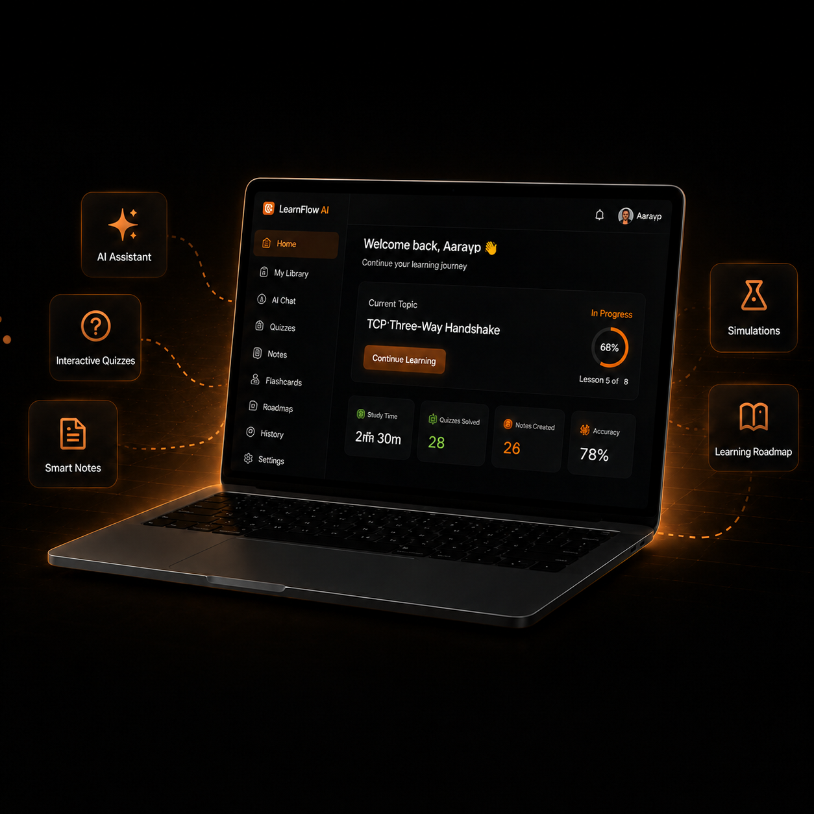
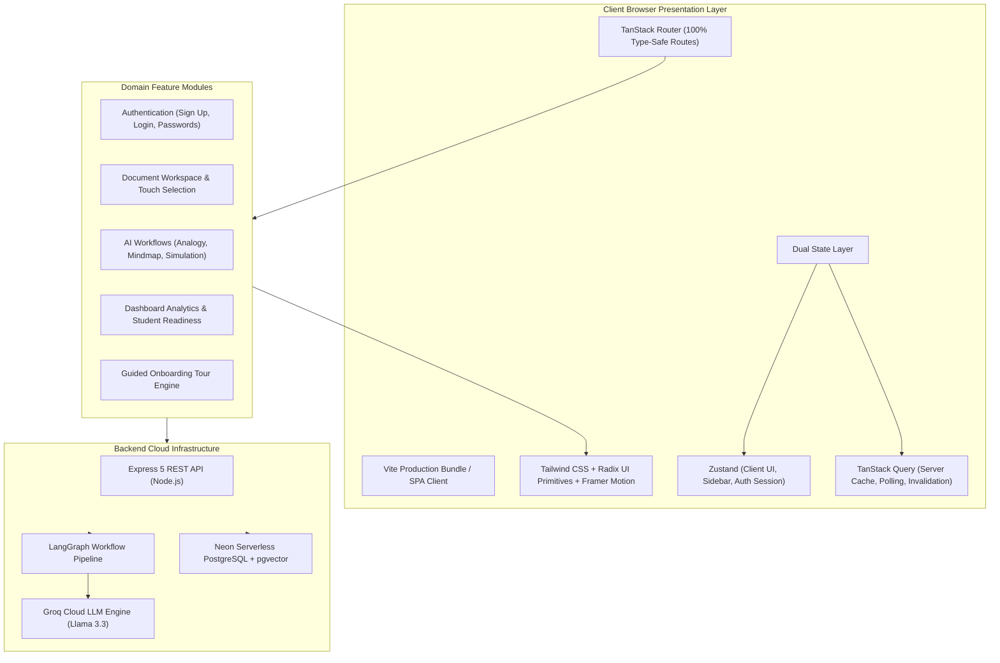
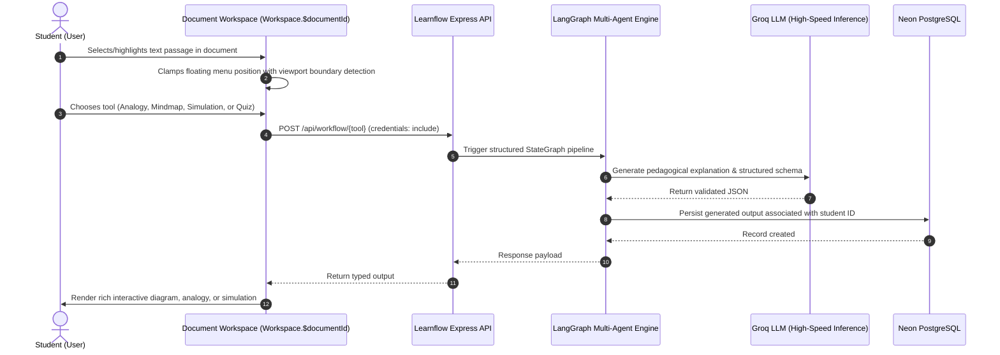
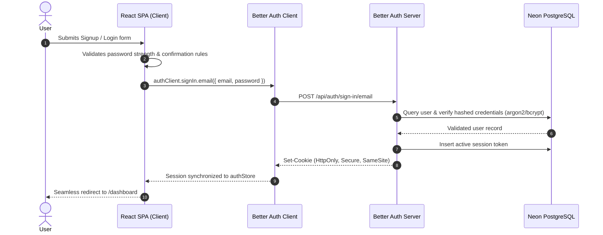

# 🧠 Learnflow AI —Context Aware Learning Intelligence Platform

<p align="center">
  
</p>

<p align="center">
  <b>Transform how students understand complex materials.</b><br />
  Upload documents, highlight concepts, and instantly generate interactive AI analogies, visual simulations, dynamic mind maps, quizzes, and structured notes.
</p>

<p align="center">
  <a href="https://learnflow-ai-prod.vercel.app"><strong>Explore Live Demo »</strong></a>
  <br />
  <br />
  
  
  
  
  
  
</p>


---

## 📸 Platform Showcase

### Light & Dark Theme Experience
Learnflow AI features a meticulously crafted design system with warm amber/orange highlights, custom glassmorphism, responsive micro-animations, and instant theme switching.

<div align="center">
  <table>
    <tr>
      <td align="center" width="50%"><b>☀️ Light Theme Workspace</b></td>
      <td align="center" width="50%"><b>🌙 Dark Theme Workspace</b></td>
    </tr>
    <tr>
      <td>
        
      </td>
      <td>
        
      </td>
    </tr>
  </table>
</div>

---

## 🌟 Key Highlights & Features

### 📄 1. Intelligent AI Document Workspace
* **Context-Aware Selection**: Seamless text selection across desktop, tablet, and mobile touch devices.
* **Instant Clarification Menu**: Highlight any sentence or paragraph to trigger specialized workflows:
  * 🎭 **Real-World Analogies**: Breaks abstract academic jargon into intuitive everyday metaphors across multiple relatable styles.
  * 🌊 **Visual Simulations**: Step-by-step entity and flow simulations demonstrating complex processes in real-time.
  * 🗺️ **Interactive Mind Maps**: Dynamic node-link diagrams powered by `@xyflow/react` and `dagre` automatic layout engines.
  * 📝 **Structured Study Notes**: Key takeaways, exam tips, and revision summaries ready for quick review.
  * 🎯 **Targeted Flash Quizzes**: Instant multi-choice quizzes tailored directly to the highlighted concept.

### 📊 2. Student Readiness & Learning Analytics
* **Readiness Score Engine**: Computes mastery scores across curriculum topics.
* **Learning Streaks**: Daily commitment tracker with visual streak counters.
* **Activity Graphs**: Interactive trend visualization powered by Recharts.
* **Smart Alert Center**: Real-time notifications for streak milestones, revision reminders, and platform updates.

### 🛡️ 3. Security & Account Management
* **Dual-Layer Password Validations**: Minimum 8 characters, uppercase/lowercase rules, numeric requirements, and real-time password strength meter (`Weak`, `Medium`, `Strong`).
* **Session Cookie Architecture**: Enterprise-ready session cookies via Better Auth with Google OAuth integration.
* **Customization Settings**: Profile bio, avatar customization, and secure password updates.

### 🚀 4. Guided Product Onboarding Tour
* Contextual walkthrough introducing the document upload zone, highlight workflow tools, and learning dashboard without cognitive overload.

---

## 🏛️ System Architecture

The frontend follows a **domain-cohesive, feature-driven architecture** that isolates business logic, ensures compile-time type safety, and prevents cross-cutting tight coupling.



---

## 🔄 Core User & AI Workflows

### 1. High-Performance Text Selection & AI Generation Flow



### 2. Secure Authentication & Session Lifecycle



---

## 🛠️ Technology Stack

| Category | Technologies | Purpose |
| :--- | :--- | :--- |
| **Runtime & Core** | React 19, TypeScript 5.8 | Modern reactive component hierarchy with strict typing |
| **Build & Bundler** | Vite 6 | Sub-2s builds, lightning-fast HMR, and optimized chunks |
| **Routing** | TanStack Router | File-based, type-safe routing with search param validation |
| **Styling & Motion** | Tailwind CSS, Framer Motion | Curated color tokens, sleek glassmorphism, micro-animations |
| **Diagrams & Graphs** | `@xyflow/react`, `dagre`, Recharts | Dynamic interactive mind maps and student analytics charts |
| **Authentication** | Better Auth | Secure cookie sessions, Google OAuth, and user profiles |
| **State Management** | Zustand & TanStack Query | Clean separation between client UI state and server caching |
| **Icons & Assets** | Lucide React, HugeIcons | High-clarity vector icons with dark-mode compatibility |
| **Notifications** | React Hot Toast | Unobtrusive, animated user notifications |

---

## ⚡ Performance & Engineering Highlights

* **Zero-Blocking Hydration**: Eradicated blocking splash overlays and body scroll locks for immediate First Contentful Paint (FCP).
* **Responsive Selection Engine**: Custom touch and keyboard selection listeners with collision-aware floating action bar positioning.
* **Sub-2s Production Compilation**: Optimized Rollup/Vite pipeline bundling 10,000+ modules in ~1.8 seconds.
* **Cross-Browser Theme Adaptability**: Dark mode and light mode use explicit CSS variables with zero flash of unstyled content (FOUC).

---

## 🚀 Getting Started

### Prerequisites
* **Node.js**: `v20.0.0` or higher
* **pnpm**: `v9.0.0` or higher

### Installation & Setup

1. **Clone the repository**:
   ```bash
   git clone https://github.com/RohitChintalapudi/Learnflowai-frontend.git
   cd Learnflowai-frontend
   ```

2. **Install project dependencies**:
   ```bash
   pnpm install
   ```

3. **Configure Environment Variables**:
   Create a `.env` file in the project root:
   ```env
   # Backend API Endpoint (Local or Production)
   VITE_BACKEND_URL=http://localhost:3000
   ```

4. **Launch Development Server**:
   ```bash
   pnpm dev
   ```
   Open [http://localhost:5173](http://localhost:5173) in your browser.

---

## 💻 Available Scripts

| Command | Description |
| :--- | :--- |
| `pnpm dev` | Starts Vite dev server with Hot Module Replacement |
| `pnpm build` | Type-checks with `tsc -b` and builds for production |
| `pnpm preview` | Serves the production build locally for verification |
| `pnpm lint` | Runs Biome/ESLint code analysis |
| `pnpm format` | Auto-formats codebase according to formatting standards |
| `pnpm check:fix` | Automatically fixes resolvable linting and style issues |

---

## 🤝 Contributing

Contributions make the open-source community an amazing place to learn, inspire, and create:
1. Fork the Project
2. Create your Feature Branch (`git checkout -b feature/AmazingFeature`)
3. Commit your Changes (`git commit -m 'feat: add AmazingFeature'`)
4. Push to the Branch (`git push origin feature/AmazingFeature`)
5. Open a Pull Request

---

<p align="center">
  <sub>Built with ❤️ by the LearnFlow AI Team. Designed for students and lifelong learners worldwide.</sub>
</p>
